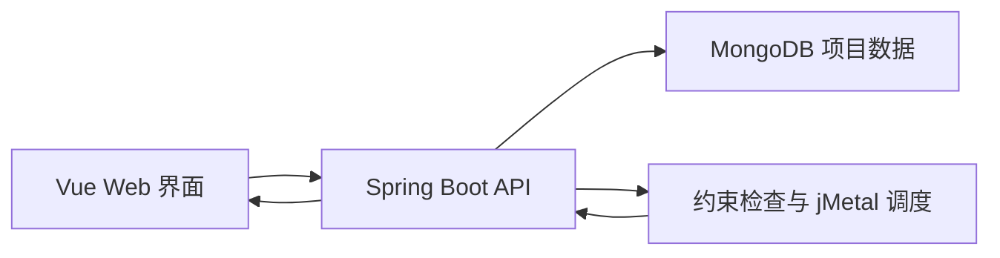

# Construction Scheduling System

**建筑工程资源约束调度系统** · Java / Spring Boot / jMetal / Vue / MongoDB

面向建筑工程任务建模和调度实验的课程项目。通过 Web 界面管理项目、活动、位置层级、工种及约束，由后端计算调度结果并交给前端展示。

## 功能概览

- **项目管理**：新建空项目或导入 Excel，保存项目模型与配置。
- **模型与约束**：维护活动、位置层级、前置关系和工种数据；包含前置关系图及时间约束检查代码。
- **调度计算**：后端使用 jMetal；当前服务实现包含 NSGA-III 求解及结果指标计算。
- **结果展示**：Vue 页面展示项目、调度结果及图表。
- **数据持久化**：MongoDB 保存项目模型，修改项目后使旧调度结果失效。

## 技术栈

| 层次 | 实现 |
| --- | --- |
| 前端 | Vue 3、Vite、Vue Router、Axios、ECharts |
| 后端 | Java 21、Spring Boot 3.5.10、Maven |
| 优化计算 | jMetal 6.10 |
| 存储与导入 | MongoDB、Apache POI |



## 本地启动

### 环境

- JDK 21 或兼容版本，Maven。
- Node.js 20.19+（20.x）或 22.12+，npm；具体范围见前端 package.json。
- 本地 MongoDB，默认地址为 `mongodb://localhost:27017/construction_db`。

### 后端

在仓库根目录打开终端：

```powershell
cd "代码/后端/constructiondemosys"
mvn spring-boot:run
```

后端默认使用 Spring Boot 的 `8080` 端口。数据库连接配置位于 `src/main/resources/application.properties`。

### 前端

另开终端，在仓库根目录执行：

```powershell
cd "代码/前端/biyesheji/Mywebsites/rcpspweb"
npm install
npm run dev
```

按终端输出访问页面，默认 Vite 开发地址为 `http://localhost:5173`。

> 根目录的一键启动脚本包含原开发机器的 JDK、Maven 路径。首次使用建议先按上述步骤启动；使用脚本前请检查这些路径及本机 MongoDB 服务名称。

## 代码导航

| 路径 | 用途 |
| --- | --- |
| `代码/前端/biyesheji/Mywebsites/rcpspweb/src/views/` | 项目、模型、约束及结果页面 |
| `代码/后端/constructiondemosys/src/main/java/construction/Controller/` | REST 接口 |
| `代码/后端/constructiondemosys/src/main/java/construction/Service/` | Excel 解析与调度服务 |
| `代码/后端/constructiondemosys/src/main/java/construction/constraint/` | 约束模型及验证 |
| `代码/后端/constructiondemosys/src/main/java/construction/problem/` | 优化问题定义 |
| `代码/后端/constructiondemosys/src/main/java/construction/schedule/` | 排程逻辑 |
| `测试数据/` | 项目 JSON 样例 |

可从 `ProjectController.java` → `SchedulingService.java` → `ConstructionSchedulingProblem.java` 阅读后端主流程，再对照前端 `src/views/` 查看交互。

## 项目定位与验证

这是课程与实验用途的系统。当前仓库中的实现与其他历史实验版本可能不同，算法数量和效果应以本仓库代码及实际运行结果为准。

本次文档整理核对了依赖、目录、接口和启动脚本；未执行完整的 MongoDB 联调、后端构建或前端运行，因此不宣称已完成跨机器启动验证。

开发接口、跨域配置和启动方式面向本地演示，尚未提供生产部署承诺。仓库未附开源许可证，使用或再分发代码前请确认授权。
